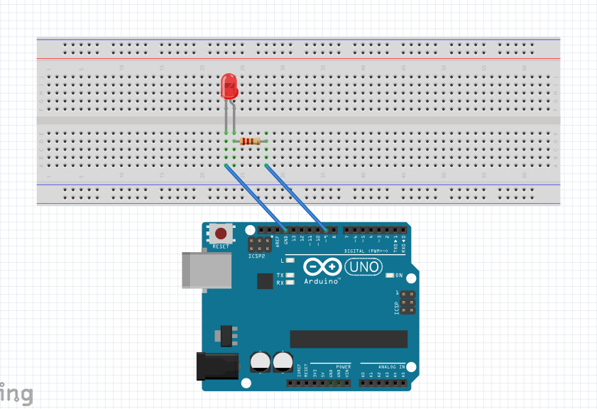

# 손가락으로 켜는 LED 조광기

p5.js(ml5 handPose)로 엄지와 검지 사이 간격을 인식해 슬라이더를 조절하고, 그 값을 아두이노로 보내 LED 밝기를 바꾸는 프로젝트입니다.

👉 **[프로젝트 페이지 보기](./index.html)**: 프로그램 소개, Fritzing 회로도, 코드 설명, 시연 영상, 어려웠던 점

## 파일 구성
| 파일 | 설명 |
|---|---|
| `index.html` | 프로젝트 소개 페이지 |
| `code/sketch.js` | p5.js 코드 (손 인식 + 시리얼 전송) |
| `code/led_brightness.ino` | 아두이노 코드 (값 수신 + LED 밝기 조절) |
| `media/circuit.png` | Fritzing 회로도 |
| `media/demo.mp4` | 시연 영상 |

## 회로
D9(~PWM) → 220Ω 저항 → LED(+) / LED(−) → GND

## 사용 방법
1. 아두이노에 `led_brightness.ino`를 업로드하고 시리얼 모니터를 닫습니다.
2. Chrome 또는 Edge에서 p5 스케치를 실행하고 **아두이노 연결** 버튼으로 포트를 선택합니다.
3. 가운데 손가락을 접은 채 엄지와 검지를 벌리면 밝아지고, 붙이면 꺼집니다.
